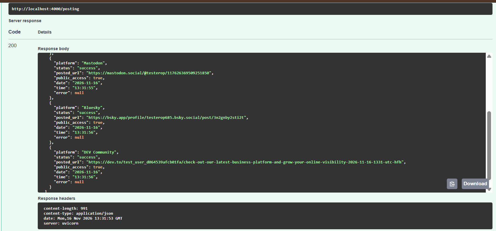
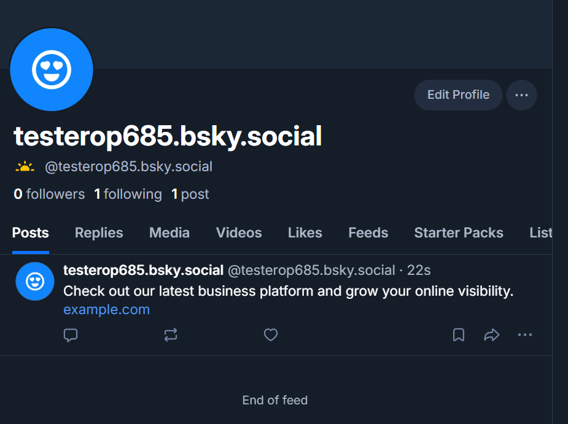
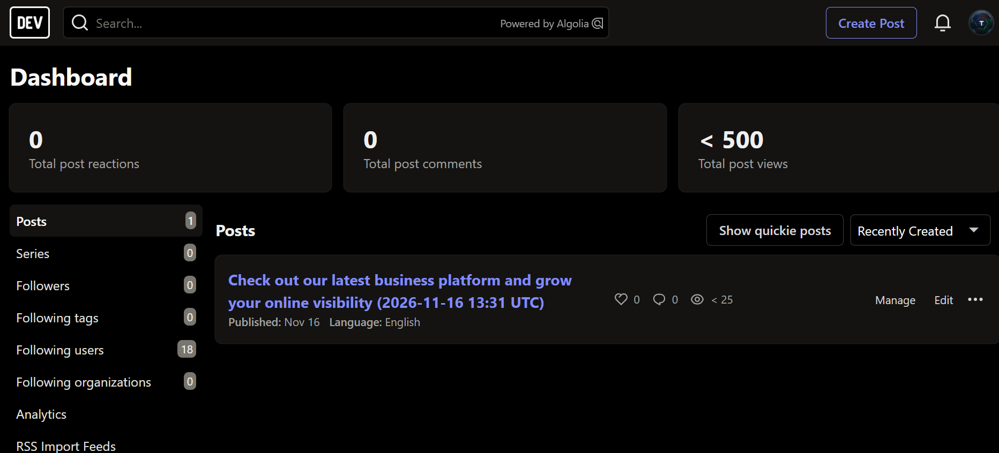
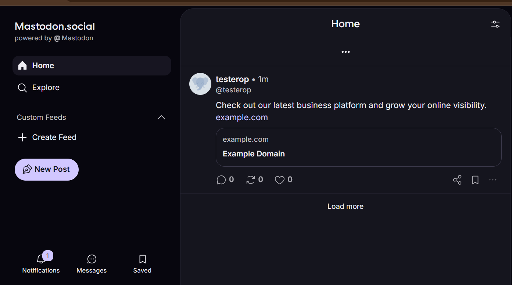

# Automated Multi-Platform Posting System

A FastAPI service that publishes one short message (max 200 chars, exactly one CTA link) to **5 third-party platforms** through their official REST APIs. Each platform is isolated: if one fails, the others still post.

| Platform | Official API docs | Auth used | Public URL returned |
|---|---|---|---|
| Telegram | https://core.telegram.org/bots/api#sendmessage | Bot token | `https://t.me/<channel>/<id>` |
| Discord | https://discord.com/developers/docs/resources/webhook | Webhook URL | message link (login required, so `public_access=false`) |
| Mastodon | https://docs.joinmastodon.org/methods/statuses/#create | OAuth access token | status URL |
| Bluesky | https://docs.bsky.app/docs/api/com-atproto-repo-create-record | Handle + **app password** | `https://bsky.app/profile/<handle>/post/<id>` |
| DEV Community | https://developers.forem.com/api/v1 | API key | article URL |

I picked these because they have free, documented, key-based APIs (no app review or paid tier) and return a real, shareable URL for the post.

## Project structure

```
automated-posting/
├── app/
│   ├── main.py                  # FastAPI app, /posting endpoint, 422 error handler
│   ├── schemas.py               # Pydantic models + message/URL validation
│   ├── config.py                # env-var settings (.env supported)
│   ├── platforms/
│   │   ├── base.py              # BasePlatform: error isolation, timestamps, public check
│   │   ├── telegram.py  discord.py  mastodon.py  bluesky.py  devto.py
│   │   └── __init__.py          # internal platform selection
│   └── services/posting_service.py   # concurrent fan-out (asyncio.gather)
├── tests/test_posting.py        # 21 tests (validation, isolation, mocked HTTP)
├── docs/                        # captured server + test logs
├── screenshots/                 # live-run screenshots
├── .env.example  requirements.txt  README.md
```

## Setup

Requires Python 3.9+.

```bash
git clone <your-repo-url> && cd automated-posting
python -m venv .venv
source .venv/bin/activate          # Windows: .venv\Scripts\activate
pip install -r requirements.txt

cp .env.example .env               # then fill in your credentials
uvicorn app.main:app --host 0.0.0.0 --port 4000
```

- API: `POST http://localhost:4000/posting`
- Swagger docs: http://localhost:4000/docs
- Health: `GET http://localhost:4000/health`

Platforms whose credentials are not set are reported as `failed` ("Missing credentials: ...") and skipped, so you can enable them one at a time.

### Getting credentials (all free)

- **Telegram**: talk to `@BotFather` -> `/newbot` -> token. Create a public channel, add the bot as admin, set `TELEGRAM_CHAT_ID=@yourchannel`.
- **Discord**: Server Settings -> Integrations -> Webhooks -> New Webhook -> Copy URL.
- **Mastodon**: Preferences -> Development -> New application, scope `write:statuses`; copy the access token.
- **Bluesky**: Settings -> Privacy & Security -> App Passwords. Use that, not your main password.
- **DEV**: Settings -> Extensions -> Generate API key.

> Use your own test accounts and keep volume low. Posting promotional links repeatedly can violate platform terms.

## Validation rules

| Rule | Result |
|---|---|
| Empty / whitespace message | 422 |
| More than 200 characters | 422 |
| Zero or more than one link (`scheme://...` or `www.`) | 422 |
| Link not `http`/`https`, bad domain, bad port, embedded credentials, `www.` without scheme | 422 |

Validation errors use a consistent shape: `{"success": false, "errors": [{"field": "message", "message": "..."}]}`.

## Sample requests and responses

### Valid request

```bash
curl -X POST http://localhost:4000/posting \
  -H "Content-Type: application/json" \
  -d '{"message": "Check out our latest business platform and grow your online visibility. https://example.com"}'
```

### Response with credentials configured (shape only; values illustrative)

`success` is `true` when at least one platform succeeded. Date and time are **UTC**.

```json
{
  "success": true,
  "results": [
    {"platform": "Telegram", "status": "success", "posted_url": "https://t.me/mychannel/42",
     "public_access": true, "date": "2026-11-16", "time": "12:49:18", "error": null},
    {"platform": "Discord", "status": "success", "posted_url": "https://discord.com/channels/111/222/333",
     "public_access": false, "date": "2026-11-16", "time": "12:49:18", "error": null},
    {"platform": "Mastodon", "status": "failed", "posted_url": null,
     "public_access": false, "date": null, "time": null,
     "error": "Authentication failed (HTTP 401): The access token is invalid"}
  ]
}
```

### Actual captured response (no credentials configured; see `docs/sample_run.log`)

```json
{
  "success": false,
  "results": [
    {"platform": "Telegram", "status": "failed", "posted_url": null, "public_access": false,
     "date": null, "time": null, "error": "Missing credentials: TELEGRAM_BOT_TOKEN, TELEGRAM_CHAT_ID"},
    {"platform": "Discord", "status": "failed", "posted_url": null, "public_access": false,
     "date": null, "time": null, "error": "Missing credentials: DISCORD_WEBHOOK_URL"},
    {"platform": "Mastodon", "status": "failed", "posted_url": null, "public_access": false,
     "date": null, "time": null, "error": "Missing credentials: MASTODON_ACCESS_TOKEN"},
    {"platform": "Bluesky", "status": "failed", "posted_url": null, "public_access": false,
     "date": null, "time": null, "error": "Missing credentials: BLUESKY_HANDLE, BLUESKY_APP_PASSWORD"},
    {"platform": "DEV Community", "status": "failed", "posted_url": null, "public_access": false,
     "date": null, "time": null, "error": "Missing credentials: DEVTO_API_KEY"}
  ]
}
```

### Validation errors (HTTP 422)

Two links:
```json
{"success": false, "errors": [{"field": "message", "message": "Message must contain exactly one CTA link (found 2)"}]}
```
Too long:
```json
{"success": false, "errors": [{"field": "message", "message": "Message must not exceed 200 characters (got 220)"}]}
```

## Design decisions

- **Failure isolation**: `BasePlatform.post()` never raises; every outcome becomes a `PlatformResult`. The service also uses `asyncio.gather(return_exceptions=True)` as a second safety net.
- **Concurrency**: all platforms are called in parallel with one shared `httpx.AsyncClient` and a configurable timeout (`REQUEST_TIMEOUT_SECONDS`).
- **Secrets**: only environment variables; `.env` is git-ignored. Error messages are built from status codes and API error text, never from request URLs, so tokens (e.g. Telegram's token-in-URL) cannot leak into responses or logs.
- **`public_access`**: set from platform knowledge where certain (Discord = false, public Telegram channel = true, Mastodon visibility) and otherwise verified with an anonymous GET of the posted URL.
- **Platform selection is internal**: the request body carries only the message.

## Tests

```bash
pytest -q        # 21 passed (see docs/test_run.log)
```

HTTP is mocked with `httpx.MockTransport`, so tests need no credentials or network. They cover validation edge cases (exactly 200 chars, trailing punctuation, bad ports and schemes), one-fails-others-continue, the Mastodon/Telegram/Bluesky request flows (including Bluesky UTF-8 link-facet offsets), token non-leakage, and timeouts.

## Live-run evidence

Real posts made with my own test accounts (Bluesky, DEV Community, Mastodon). Telegram and Discord are implemented and tested with mocked HTTP, but were not run live because they require phone verification.

**Swagger response with 3 platforms succeeding**



**Bluesky post**



**DEV Community post**



**Mastodon post**



Server logs from a local run are in `docs/sample_run.log`.